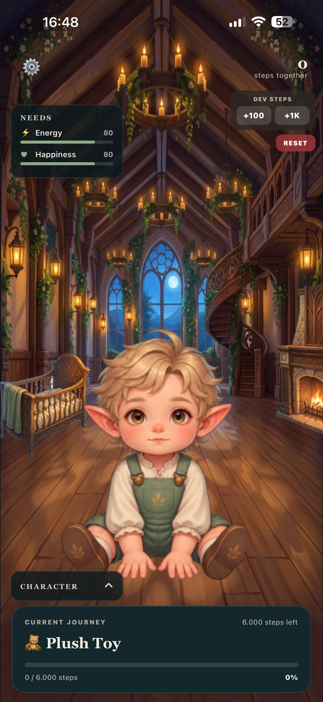
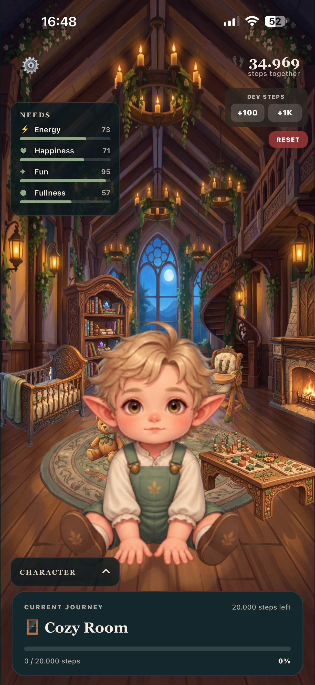

# Walkmon

### Every step brings your world to life.

Walkmon is a walking-powered fantasy life simulation game for iOS, built with React Native, Expo, and TypeScript.

The idea is simple: **your real-world movement drives progress in a virtual world.**

Instead of treating walking as just another fitness statistic, Walkmon transforms daily steps into meaningful game progression. Players raise a fantasy character, unlock new objects, and watch their environment evolve as they stay active.

## Screenshots

<p align="center">
  
  
</p>

<p align="center">
  <strong>Initial Version</strong> &nbsp;&nbsp;&nbsp;&nbsp;&nbsp;&nbsp;&nbsp;&nbsp;
  <strong>Current Version</strong>
</p>

<p align="center">
  From the first prototype to the current playable version.
</p>


## Gameplay Demo

A short preview of Walkmon's gameplay, featuring character
movement, autonomous interactions, and room progression.

https://github.com/user-attachments/assets/b244feed-0950-4547-8451-cb673e996004


## Key Features

**Real-World Step Integration**

- Reads walking activity through Apple HealthKit.
- Connects real-world movement to in-game progression.
- Rewards consistency and physical activity through gameplay.

**Character Life Simulation**

- A fantasy character with needs such as hunger, sleep, play, reading, and activity.
- Autonomous character behavior and movement.
- Animated interactions with objects in the environment.
- Character statistics and needs displayed through dedicated HUD components.

**Progressive Game World**

- A cozy fantasy nursery as the first playable environment.
- Step-based milestones that unlock interactive objects.
- Visual progression as the room develops.
- A foundation for future life stages and environments.

**Animation and Interaction**

- Animated character movement and activities.
- Custom character sprites and environment assets.
- React Native Skia and Reanimated for rendering and animation.

**Persistent Progression**

- Local game-state persistence using AsyncStorage.
- Saved step progression, milestones, character needs, and statistics.
- Architecture designed to support future progression systems.

## Tech Stack

| Technology | Purpose |
|---|---|
| React Native | Cross-platform application framework |
| Expo | Development and native build tooling |
| TypeScript | Type-safe application logic |
| Apple HealthKit | Real-world walking activity |
| React Native Skia | Custom 2D rendering |
| React Native Reanimated | Animations |
| AsyncStorage | Local game persistence |
| Swift / Xcode | Native iOS integration and builds |

## Architecture

Walkmon separates gameplay mechanics from presentation and native integrations.

The project includes dedicated modules for:

- **Game controller:** Coordinates gameplay state and interactions.
- **Progression:** Handles milestones and character development.
- **Character needs and stats:** Manages the simulation state.
- **Movement and autonomy:** Controls character navigation and autonomous behavior.
- **Game locations:** Organizes world locations and transitions.
- **HealthKit integration:** Retrieves walking activity.
- **UI components:** Displays needs, statistics, milestones, and unlock animations.

This modular structure makes it easier to extend the game with new environments, character stages, and gameplay systems.

## Development Status

**Active development — early playable prototype**

The first playable environment focuses on an elf baby character living in a fantasy nursery.

Implemented foundations include:

- Baby Room environment
- Step-based progression and unlockable objects
- Character needs and statistics
- Autonomous movement and interactions
- Character animations
- Local game-state persistence
- Apple HealthKit integration

Current development focuses on improving the game architecture and preparing the next character life stage.

### Roadmap

Planned features include:

- Additional character life stages
- Expanded environments and progression
- Multiple fantasy character races
- Improved animations and interactions
- Optional accounts and cloud synchronization
- Cosmetic customization

*Roadmap items are planned features and are not necessarily implemented.*

## Getting Started

### Prerequisites

- Node.js and npm
- macOS and Xcode for native iOS builds
- An iOS device for testing HealthKit functionality

### Installation

```bash
git clone https://github.com/Burak-Giritlioglu/walkmon.git
cd walkmon
npm install
```

### Run on iOS

```bash
npx expo run:ios
```

### Start the development server

```bash
npx expo start
```

Because Walkmon uses native HealthKit functionality, a native development build is required for testing the full iOS experience.

## Project Vision

Walkmon explores a different approach to activity-based games.

Rather than displaying steps as numbers, the game turns everyday movement into an evolving fantasy experience.

**Walk in the real world. Grow in another.**

## License

See the [LICENSE](LICENSE) file for licensing information.
